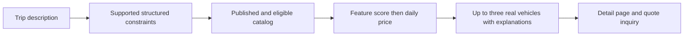

# AI and recommendation design

The showcase is a deterministic natural-language concierge grounded in the marketplace database. It runs without a paid model or API key. The no-key interpreter is rules-based. An optional provider adapter is implemented; an actual external-model invocation must be verified separately. Neither path is a trained marketplace recommendation model.

## Pipeline and authority

`services/api/app/concierge.py` interprets user text, queries the same public-eligibility rule as catalog/detail/inquiry endpoints, and builds cards from actual records. A listing must be published, not administratively hidden and owned by an approved, active supplier in an active location hierarchy. No text-generated listing IDs, prices or specifications are trusted.

## Supported constraints and limitations

The interpreter normalizes number words one through twelve to digits. It requires exactly one recognized seeded city; missing or multiple recognized cities produce a clarification. AED/USD must agree with the destination. Recognized unsupported currencies such as EUR, GBP and MAD prompt clarification; this is a finite list, not a universal currency parser.

Budget expressions include “under”, “below”, “less than”, “max”, “maximum”, “budget” and “up to”. The first three enforce a strict upper bound; the others allow equality. Explicit weekly/monthly/whole-trip budget wording prompts a daily-budget clarification. Daily, weekly and monthly prices are not converted into one another. Supported passenger expressions specify seats, people, passengers or adults; “with my wife”, “with my husband” and “couple” imply two seats. A day count is extracted as `duration_days` but does not check dates, compute a whole-trip quote or verify availability.

The first matching category in SUV, Convertible, Electric, Supercar, Sports, Economy, Luxury is selected. This is a single primary-category interpretation; “luxury SUV” selects SUV. Arbitrary negation, relative-price comparisons, multiple alternatives and unrestricted natural language are not fully understood. The backend request is stateless. The frontend carries sanitized recognized trip constraints into a clarification follow-up; this is limited context handling, not unrestricted conversational memory. Explanations describe recognized matches and direct special requests to supplier confirmation.

## Ranking and explanation

City, currency, category, budget and minimum seats are SQL constraints. The query retrieves at most 100 eligible candidates, ordered by daily price and ID. Recognized preferences are navigation, Bluetooth, leather, panoramic and climate control. Each preference present in stored features contributes one point; candidates sort by descending preference count, ascending daily price, then ID. Only the first three are returned.

The bounded candidate set favors affordable offers; an expensive feature match outside the first 100 is not considered. This is a documented trade-off, not a globally optimal ranking guarantee. The service returns fewer than three when fewer match and never fills missing results with invented inventory. Explanations state stored location, illustrative daily rate, seats/category and matched features. There are no fabricated match percentages, learned accuracy claims or market-demand forecasts.

## Supplier listing assistant

`POST /api/v1/ai/listing-assistant` requires supplier authentication and accepts notes using the same bounded request schema. It recognizes existing model names and their associated brands, year, city/country, explicit AED/USD daily rate, seats, transmission, explicit category and supported feature phrases. It builds a concise description from recognized fields and returns `suggestions`, `missing_fields`, `warnings` and `mode`.

The supplier form previews suggestions. **Apply suggestions to draft** updates editable form fields; it does not save or publish. The supplier still reviews fields, fills gaps, uploads photos, saves and submits through normal authorization and validation. Unmentioned specifications are not inferred from brand reputation or photos. The parser is limited and its missing-field report must remain visible; suggestions are not verified vehicle facts.

## Insights and safeguards

`GET /api/v1/ai/marketplace-insights` returns listing/lead status counts, totals, inquiries grouped by category, the five most inquired-about listings and factual templated summaries. Supplier users receive their own aggregates; administrators receive marketplace aggregates. The Insights tab renders these values. Detail API events support most-viewed listings and raw inquiries per 100 detail requests. Repeated, automated and demo calls count; this is not unique-visitor attribution or a causal conversion estimate. Category counts use the primary category. No revenue forecast is implemented.

Business rules remain outside the interpreter. User text and descriptions cannot authorize writes, bypass approval, create a reservation or confirm availability. Customer contact data and licence fields are not needed for these requests. Ordinary fleet browsing and inquiries remain independent of the concierge. Every inquiry is a request for supplier confirmation.

## Explicit preference recommendations

`POST /api/v1/ai/recommendations` accepts a validated city/currency, maximum daily rate, minimum seats, category, required features, preferred categories and occasion. The concierge page exposes these through its preference controls. Hard constraints cannot be relaxed. Required feature names must match stored feature names case-insensitively.

The candidate set contains the lowest-priced 500 publicly eligible rows matching SQL constraints; required features are then checked. A preferred-category match adds 20 points and a documented occasion-category editorial match adds 10. Ties sort by daily price and ID. Return at most three records. This score is an explicit ranking rule, not a predicted probability. The bounded pool can miss a more expensive feature match beyond 500 candidates.

## Optional provider implementation and limits

`app/provider.py` reads `AI_API_KEY`, `AI_MODEL` and `AI_BASE_URL` (default `https://api.openai.com/v1`). With no key/model or a non-HTTPS base it uses deterministic fallback. It makes a bounded chat-completions JSON request with an eight-second timeout and redirects disabled. HTTP, response parsing and schema failures fall back rather than break catalog discovery.

Outbound input is a finite allowlist of travel tokens/cities/numbers after common email, URL, phone and credential patterns are scrubbed. This reduces exposure; it is not a complete PII classifier and must not be advertised as guaranteeing that all sensitive content is removed. The adapter receives no customer lead records or supplier verification records.

The provider response is constrained to city, category, budget, seats and occasion. Unknown properties and invalid values are rejected; catalog city/category values are checked. Existing deterministic hard constraints remain authoritative. Additional model constraints require matching evidence in the input, and occasion scoring requires an explicitly mentioned supported occasion. Inventory IDs, prices, specifications, authorization and publication remain database/backend responsibilities. `mode` reports deterministic or provider-assisted; the latter means valid extraction was returned, not that a real-world reservation was verified.

Real external-provider invocation is not established merely by an implemented adapter or mocked tests. See the latest verification report for the actual run scope. Supplier note assistance and insight summaries remain deterministic even when this concierge adapter is configured.

## Local image assistance

Uploads report resolution, brightness and edge-detail warnings, a deterministic cover-candidate score and identical normalized-image hash matches within the supplier account. Resolution contributes up to 40 points, balanced brightness 30 and edge detail 30. These are basic image heuristics; a plain image can resemble blur, and no vehicle identity, ownership or specifications are verified.

## Verification

The backend suite covers database grounding, capacity, currency rejection, duration extraction, strict budget boundaries, supplier suspension and suggestion generation without saving. See `IMPLEMENTATION_STATUS.md` for the executed result. Current coverage is representative, not proof that all natural-language constructions are interpreted correctly.
