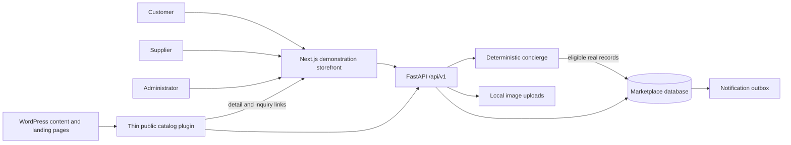

# Architecture

This repository demonstrates a Type A vehicle listings marketplace: supplier → listing → approval → public discovery → inquiry. It is an unofficial concept with synthetic inventory. It has no checkout, payouts, insurance, transactional reservations or authoritative availability system.

## Ownership and request flow

FastAPI is the sole authority for users, suppliers, listings, moderation and inquiries. Next.js renders the proposed customer experience and supplier/admin workflows. WordPress remains the intended production owner of public marketing, editorial and SEO pages. This demonstration does not modify or replace the live LavishCars website.

The backend is a small modular monolith. SQLAlchemy models and Pydantic input validation keep persistent state and request contracts explicit. PostgreSQL is the deployment target; SQLite supports local demo/test convenience. See the root README and implementation status for the actual setup and verification performed.

## Core flow

1. Supplier registration creates a supplier account subject to review; public registration cannot create an administrator.
2. A supplier creates a listing owned by its authenticated supplier identity and submits it for moderation.
3. An administrator approves supplier eligibility and listing publication. Public discovery joins listing and supplier eligibility and excludes administratively hidden offers, so suspension removes offers without deletion.
4. A customer filters the catalog or describes a trip. The concierge interprets supported constraints and retrieves eligible database records.
5. The customer opens a detail page and sends an inquiry. The backend derives the supplier from the eligible listing and persists the inquiry with notification-outbox state.
6. Authorized supplier and administrator users inspect and update CRM outcomes. Notification failure must not erase the inquiry.

## Security boundaries

Passwords are hashed with salted scrypt. Bearer sessions have random raw tokens, stored token hashes and expiration. API dependencies enforce roles; supplier operations must enforce record ownership. SQLAlchemy issues parameterized queries. Input models reject extra fields and constrain prices, dates and listing content. Uploads are decoded and re-encoded, bounded to 8 MB, and stored under supplier-specific paths; listing writes reject uploads owned by another supplier. Login, registration, inquiry and concierge POST requests have a process-local rate limiter. The frontend currently stores bearer tokens in localStorage, requiring stronger XSS/session hardening before production. API origin configuration, upload validation, and endpoint-level protections remain backend responsibilities; frontend hiding is not authorization.

Verification fields and private leads are not part of the public WordPress catalog. The WordPress adapter escapes remote data, uses a server-configured API origin, disables redirects and bounds response size/time. It stores no marketplace authority. See `integrations/wordpress/README.md` for setup and limitations.

This is a demonstration security baseline, not a completed production security assessment. Production work includes secret rotation, hardened deployment/session handling, shared anti-abuse controls, operational alerting, backups, external notification delivery and a privacy/retention review.

## WordPress rollout

The provided shortcode renders a bounded catalog and routes detail/inquiry navigation to Next.js. The bridge was activated in local WordPress/PHP and verified for catalog rendering, detail links and suspension/restoration. This does not verify the company theme or production integration. Production integration still needs WordPress-rendered public vehicle pages, canonical/permalink decisions, tested inquiry integration, structured data and cache invalidation. Existing location and editorial URLs can remain in place while API-backed components are introduced gradually.

## Scaling trade-offs

A single backend/database keeps approval, visibility and lead ownership consistent and is sufficient to validate the product. Pagination and relational indexes provide a starting point; no throughput or scale target has been measured. Next steps should follow observed load: inspect query plans, move uploads to object storage, introduce event-driven cache invalidation, and add a real outbox worker. Only then evaluate dedicated search or separately deployed AI services.

The schema now includes normalized membership, service-area, multiple-category and ordered-image associations, with separate supplier activity. Features remain a JSON array. Local filesystem and durable database image modes support the demo; object storage and lifecycle cleanup remain production work. See `DATABASE.md`.
